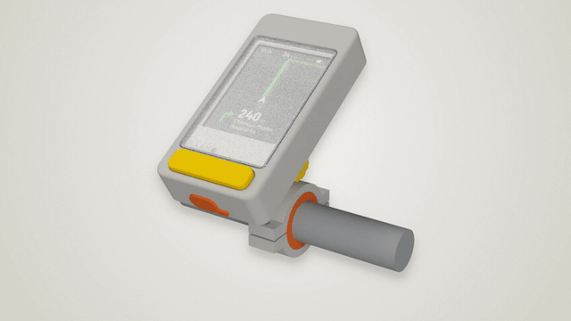
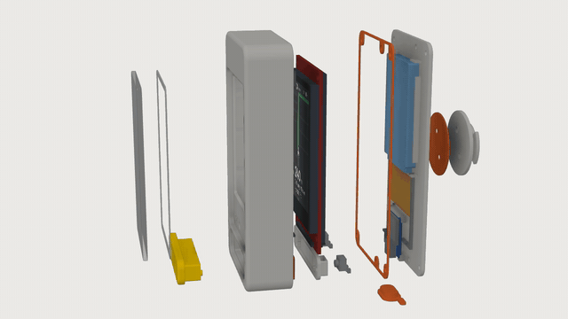
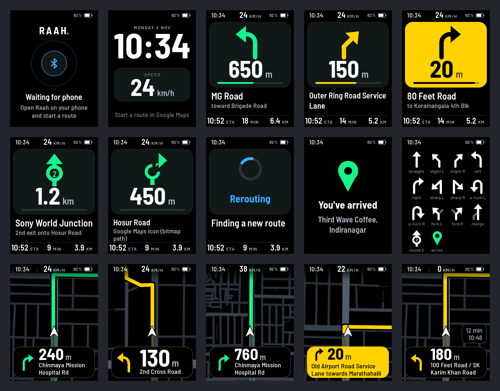
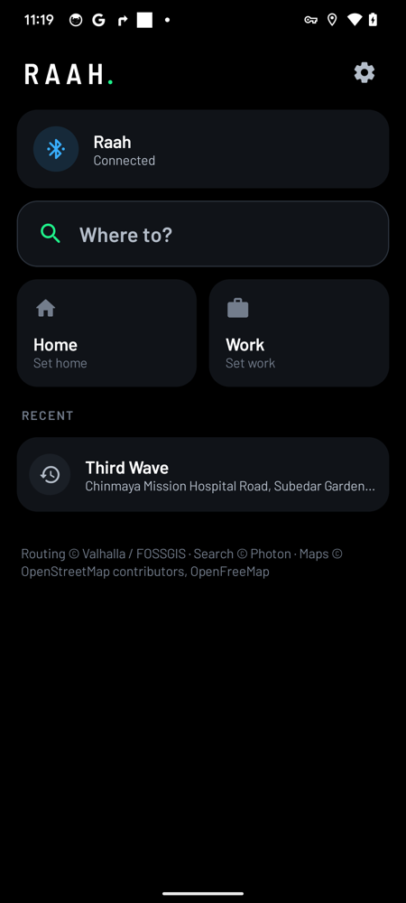
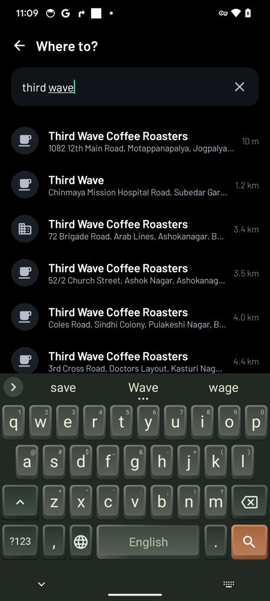
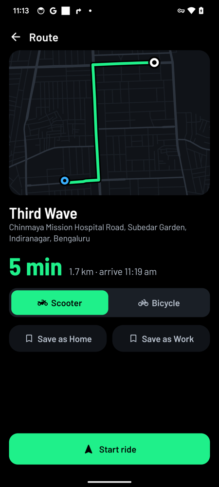
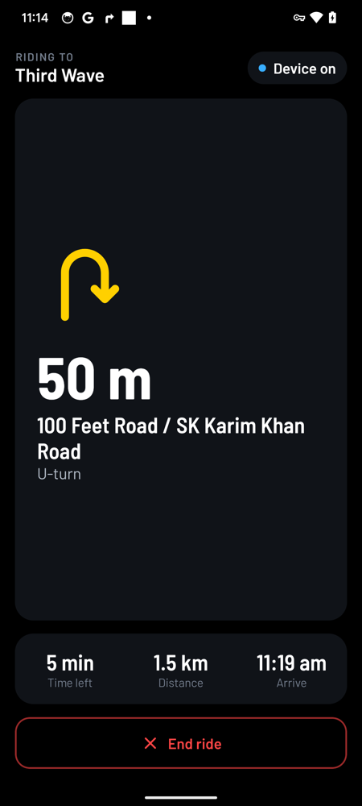
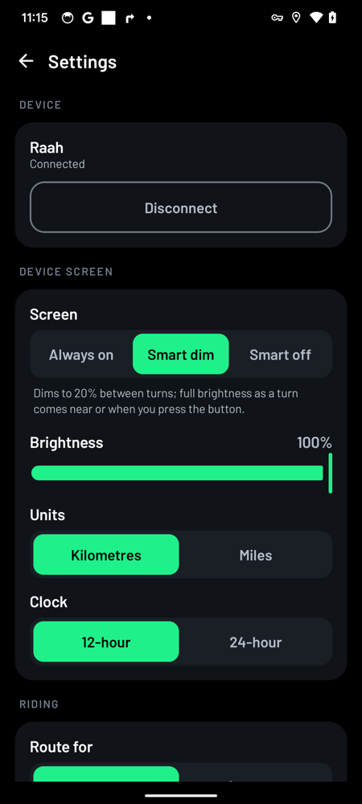

# Raah

*Raah* (राह) means "the path". It is a glanceable navigation display for a bicycle or scooter, built from a Seeed XIAO ESP32C3 and a 240×320 ILI9341 SPI TFT. Your Android phone does the routing and sends the device what to draw over Bluetooth LE.

**[Download the Android app](https://github.com/cupcake08/raah/releases/latest)** · firmware for the ESP32-C3 (and the ESP32-S3 test board) in [`firmware/`](firmware) · 3D-printable case in [`case/`](case)

<p align="center">
  
  
</p>

Videos, 720p: [assembly](case/renders/raah_assembly.mp4) · [product film](case/renders/raah_showcase.mp4) · [turntable](case/renders/raah_turntable_hq.mp4). Stills are in [`case/renders/hq/`](case/renders/hq).



## Modes

| Mode | What the rider sees | Where the data comes from |
|---|---|---|
| **Map** (screens 11–15) | A full-screen, heading-up street map that runs up under the status bar, with roads drawn by class, the route ahead in bold, and a chevron for the rider. The turn (arrow, distance, street) floats on a card at the bottom. When stopped, time left and arrival appear above the card. As a turn nears, the map zooms in to keep it in view. Between GPS fixes the map glides, so it turns smoothly into bends. | The Raah app routes the ride, fetches nearby OpenStreetMap roads, and streams them as local metres. |
| **Turn card** (screens 03–08) | A big maneuver arrow, the distance, the street name, and ETA/time/distance. | Either the Raah route or Google Maps mirroring (the app reads the Google Maps navigation notification). |
| **Idle / wait / arrived / sleep** | The clock, your speed, the battery, and the link state. | The phone sends the time; the device measures the battery itself. |

The map is an extra screen; the card screens stay. A click on the button flips between the two while navigating. When no map geometry is available, such as while mirroring Google Maps, while rerouting, or before the first tiles arrive, the device falls back to the turn card on its own.

## Phone app

| Home | Search | Route | Ride | Settings |
|---|---|---|---|---|
|  |  |  |  |  |

The app uses the device's look: a black ground, the same Barlow typeface, and the same four signal colours.

* **Home:** the device's link and battery, one large "Where to?" field, Home and Work tiles, and recent places with their distance from you. Most rides start with one tap.
* **Search:** results appear as you type. A pause of 250 ms sends the query, and a newer keystroke cancels the older request. Raah asks the phone's own geocoder (Google, on phones with Play services) and Photon (OpenStreetMap) at once, both biased to your position, and lists Google's answers first. Places within 60 km come first, nearest first, so the café in town beats a famous namesake 400 km away. A place found by both shows once. Each result shows an icon for its kind (café, food, fuel, transit and so on) and its distance. Typing coordinates such as `12.9719, 77.6412` gives a dropped pin. When Raah can't find a place, one tap searches it in Google Maps.
* **Share to Raah:** in Google Maps, tap Share on a place and pick Raah. The app follows the `maps.app.goo.gl` link; Google's links name the place but often carry no coordinates, so Raah looks up its name and address and plans the ride. `geo:` links, directions links and text with coordinates also work.
* **Shortcuts:** long-press the Raah icon for Ride home, Ride to work and Search. Long-press a recent place to forget it.
* **Route preview:** before you ride, the route is drawn over the streets around it, with the time, distance and arrival time. You can switch between scooter and bicycle routing and save the place as Home or Work.
* **Ride:** shows what the device shows: the arrow, the distance and the street. The arrow turns yellow as the turn nears, and the whole card goes yellow at the turn. Below are time left, distance and arrival time. Ending the ride takes two taps, so a brushed glove doesn't end it.
* **In a pocket:** a ride keeps going with the screen off or another app in front. It runs in a foreground service that holds the CPU awake while riding, and its notification shows the next turn and distance on the lock screen. Home asks once to lift the phone's battery limits for Raah.
* **Settings:** the device's screen mode (always on, smart dim, smart off), brightness, units, clock, default vehicle, saved places and Google Maps mirroring.

## Design

The screen is read in a glance, in daylight, on a TN panel. Everything follows from that.

* **Black ground, white figures, four signal colours with one meaning each.** Green is the route and "go". Yellow means a turn is near; at the turn the whole panel fills yellow with black ink, like a hi-vis sign. Blue is the phone link and the system working (waiting, rerouting). Red is reserved for battery and faults. Greys only carry secondary text and the map, and nothing the rider must read is darker than `TEXT3`, because dark greys vanish off-axis on this panel.
* **One hero per screen.** The arrow and the distance are the largest things on the screen; the street name comes next; the trip figures and status are small.
* **Names are never cut with "…".** A street name steps down a font size (26 → 22 → 18 px), then abbreviates street types ("Road" → "Rd", "toward" → "to"), then wraps to two lines before anything is dropped. Only text that fits none of those gets dots. The map card keeps its size: a long name gets a smaller distance (64 → 44 px) and a two-line name, and the longest names move under the arrow, across the full width of the card.
* **The map is the hero of the map screen.** The turn card floats over the road already ridden, which the map would otherwise show behind the rider. The rider chevron sits just above the card, so nearly the whole map is road ahead.
* **Repaint only what moves.** A map change repaints around the card, never inside it. The map runs on under the status bar, behind a fade. Each strip draws only the roads that cross it. While gliding, a frame is drawn only when the view moves by 2 px or more; with the screen dimmed, 6 px and at most 4 frames a second. A dark screen draws nothing, and is redrawn once before it lights.

A round 412×412 layout of the map screen also exists (`docs/screens/round_*.png`) in case a round panel is ever used. The ILI9341 build does not need it.

## Map pipeline

```
Android (Raah app)                                   ESP32-C3
───────────────────                                  ────────
GPS fix + heading ─┐
route (Valhalla motor_scooter │ Google Routes TWO_WHEELER)
                   ├─► project to metres around an anchor ─BLE─► rotate · scale · draw (LVGL)
OSM roads near the route (OpenFreeMap vector tiles / Overpass)
  └ classify: major / mid / minor / service, simplify (Douglas-Peucker)
```

* The device never parses tiles. It receives `map_pt_t {int16 x, y}` points in metres east and north of an anchor, polylines tagged with a road class, the route polyline, and a rider pose at about 1 Hz. The phone moves the anchor as the rider travels.
* The size is small. The demo area is a 1.1 km radius in Indiranagar, Bengaluru: 800 roads and 2,194 points, about 10 KB. At 2M PHY / MTU 247 that sends in well under a second.
* Rendering is in `ui/ui_map.c`. Roads are drawn in four widths and greys. The ridden part of the route is a faint trail; the part ahead has a dark casing and ink coloured by turn urgency. Polylines outside the strip being flushed are culled.
* `tools/osm_demo.py` builds `sim/demo_map.h` from live OSM data, the same way the app will.

## Hardware

The case in [`case/`](case) is built around a **Seeed XIAO ESP32C3**. Its own charger and 3.3 V regulator
replace a separate TP4056 and LDO. The firmware also still builds for the ESP32-S3 board it was developed on
(below).

| Part | Notes |
|---|---|
| Seeed XIAO ESP32C3, the standard one with an FPC antenna | The C3 has no antenna of its own: BLE needs the FPC plugged into the U.FL socket. |
| 2.4"/2.8" ILI9341 240×320 SPI TFT | The common red-PCB module. An IPS version, if you can find one, is much easier to read in sunlight than TN. The TN module has one bad viewing side: from there, dark greys turn pale and colours shift (yellow looks cyan). If that is the side the rider looks from, mount it the other way up and set **Mirror X** and **Mirror Y** in menuconfig. |
| 523450 LiPo, 1500 mAh, with protection | On the XIAO's BAT pads. It charges from the XIAO's USB-C at about 380 mA. |
| 2 × 1 MΩ resistors + 100 nF capacitor | Battery divider (2 µA). |
| Two 6×6 tact switches, in parallel | The key. The firmware sees one button. |
| GL5528 LDR + 10 kΩ | Auto-brightness. |

### Wiring (defaults in `idf.py menuconfig → Raah`)

| XIAO pin | GPIO | Goes to |
|---|---|---|
| 3V3, GND | | Display VCC and GND, LDR, key, dividers |
| D4 | 6 | Display SCK |
| D5 | 7 | Display SDI (MOSI) |
| D10 | 10 | Display CS |
| D8 | 8 | Display DC |
| D7 | 20 | Display RESET |
| D6 | 21 | Display LED (PWM; the module's on-board transistor drives the LEDs) |
| D3 | 5 | Key: both switches to GND. Only GPIO0–5 can wake the C3 from deep sleep. |
| D2 | 4 | Battery: BAT+ → 1 MΩ → D2 → 1 MΩ → GND, 100 nF from D2 to GND (the capacitor feeds the ADC's sampling charge) |
| D1 | 3 | LDR: 3V3 → GL5528 → D1 → 10 kΩ → GND |
| D0, D9 | 2, 9 | Free: strapping pins |

The display's SDO (MISO) and touch pins stay unconnected. The XIAO has no charge-status pin. D6 and D7 are
the UART pins, so the console runs over the native USB port.

### ESP32-S3 test board

An Edgehax S3 Pro (ESP32-S3-WROOM-1 N16R8) or ESP32-S3-DevKitC-1, which share a header layout. PSRAM
isn't used. Power it from a TP4056 charger (with protection) and a low-Iq 3.3 V LDO (ME6211 / HT7333 /
MCP1700) into the **3V3** pin: the DevKit's own AMS1117 drops too much voltage and draws too much
quiescent current for LiPo use.

| ILI9341 pin | ESP32-S3 |
|---|---|
| CS | GPIO4 |
| RESET | GPIO5 |
| DC | GPIO6 |
| SDI (MOSI) | GPIO7 |
| SCK | GPIO15 |
| LED | GPIO16 |

CS to LED are six neighbouring pins on the left header, in the module's own order. GPIO9–14 stay free
because the S3 Pro wires its microSD slot to GPIO10–14; GPIO35–37 belong to the N16R8's octal PSRAM, and
GPIO40–42 drive the S3 Pro's three LEDs.

| Other | ESP32-S3 |
|---|---|
| Button → GND | GPIO0, the DevKit's BOOT button (wakes from deep sleep) |
| Battery + → 1M → **GPIO1** → 1M → GND, 100 nF from GPIO1 to GND | ADC1 |
| TP4056 CHRG (optional) | set `RAAH_PIN_CHARGING` |
| LDR → 3V3, resistor → GND, junction → ADC pin (optional) | set `RAAH_PIN_LDR_ADC` |

## Battery life

These are estimates for an ILI9341 module and have not been measured yet. Measure them on your own board with a USB power meter.

| State | Approx. current |
|---|---|
| Backlight 100 % / 20 % | 60–80 mA / 12–16 mA |
| ESP32-C3 or -S3: BLE connected, DFS 40–160 MHz, auto light sleep | 4–8 mA |
| Map redraw at 1 Hz (full frame ≈ 30 ms of SPI at 40 MHz) | +3–5 mA |
| Deep sleep | XIAO ESP32C3 about 45 µA, plus the sleeping panel and up to 0.3 mA through the LDR in daylight; ≈ 1 mA on the S3 DevKit (power LED and USB bridge) |

With a 1500 mAh cell:

* **Turn-card mode, smart backlight** (lit near turns, dark while cruising): roughly 25–40 mA, so **35–60 h**.
* **Map mode, backlight always on at 60 %**: roughly 55–65 mA, so **20–25 h**.

The backlight is the main cost. Press the button twice to cycle the backlight between always on, smart dim, and smart off.

## Controls

* **Click:** on a dark or dimmed screen, wake it for 12 s. On a lit screen while navigating, flip between the map and the turn card.
* **Double click:** cycle the backlight mode.
* **Long press (2 s):** sleep. Press again to wake.
* **Keep holding (about 10 s):** the screen goes dark and the device restarts into USB download mode instead of sleeping. The XIAO's BOOT and RESET buttons are sealed in the case, so this is the way back from firmware that won't take a flash. Flash it, or unplug the battery and USB to leave.

## Build

```bash
. ~/esp/esp-idf-v6.0.1/export.sh
cd firmware && idf.py build flash monitor    # the XIAO ESP32C3
```

For the S3 test board, run `idf.py set-target esp32s3` once first. Each board's own settings (flash size,
console, LVGL memory) are in `sdkconfig.defaults.<target>`; the pins default per target in `Kconfig.projbuild`.

The Android app (JDK 17+):

```bash
cd android
./gradlew assembleDebug      # app/build/outputs/apk/debug/app-debug.apk, with the ride simulator below
./gradlew assembleRelease    # app/build/outputs/apk/release/app-release.apk: R8-shrunk, about 1.2 MB
./gradlew testDebugUnitTest  # parsing, ranking, sharing and a full route → BLE capture
```

Release builds are signed with the key in `~/.raah/keystore.properties` (`storeFile`, `storePassword`, `keyAlias`, `keyPassword`) if it exists, and with the debug key otherwise.

The host simulator renders every screen to BMP without hardware:

```bash
cmake -S sim -B build-sim -G Ninja && ninja -C build-sim raah_sim
./build-sim/raah_sim out/            # 240×320 screens + contact sheet
./build-sim/raah_sim out-round/ round # 412×412 round map screens
```

The debug build of the app can ride a route without leaving the desk (`app/src/debug/.../DemoRide.kt`). It feeds the app GPS fixes along the route, through a mock provider when Location is on and directly otherwise:

```bash
adb shell am broadcast -n app.raah/.debug.DemoRide -a app.raah.debug.FIX  --ed lat 12.9719 --ed lon 77.6412
adb shell am broadcast -n app.raah/.debug.DemoRide -a app.raah.debug.GO   --es query "'Indiranagar metro station'"
adb shell am broadcast -n app.raah/.debug.DemoRide -a app.raah.debug.RIDE --ef kmh 25 --ef detour_at 250
```

With `detour_at`, the rider leaves the route sideways after that many metres, waits for the reroute, then rides the new route to the end.

## Layout

```
firmware/  ESP-IDF app: display (esp_lcd + LVGL glue), NimBLE GATT link, power/PM, UI task
ui/        platform-free LVGL screens, nav model + wire format, vector map, fonts (Barlow, OFL)
sim/       host renderer for the UI, demo OSM map
tools/     font generator, OSM demo-map builder
docs/      screenshots
bench/     render benchmark shared by the simulator and the firmware (CONFIG_RAAH_BENCH)
android/   companion app: BLE link, Valhalla routing, OpenFreeMap roads, Photon search, Google Maps mirroring
case/      3D-printable enclosure and handlebar mount (Fusion 360 script, STEP/STL exports, renders)
```

## Status

* Runs on the Edgehax S3 Pro (ESP32-S3-WROOM-1 N16R8) with an ILI9341 panel; the Android app connects to it over BLE. The XIAO ESP32C3 build compiles but hasn't run on a board yet. The numbers below are from the S3.
* Frame time on the chip (160 MHz, SPI 40 MHz) for the benchmark's riding frame: **63 ms**, down from 96 ms. Rides on the desk average 33–53 ms a frame. A standstill with GPS jitter costs 1.8 ms and draws no pixels. The firmware logs a frame-time line every 10 s while the screen changes (`ui: N frames …, backlight N%`), and `screen on` / `screen off`.
* Where the 33 ms went, measured per object on the chip (`ui_bench_parts`):

  | Change | Riding frame |
  |---|---|
  | Before | 96 ms |
  | Status bar on a solid band, so map frames skip its text (it cost 9.6 ms a frame) | 88 ms |
  | Circle cache 4 → 16 slots: round caps, card corners and arrow strokes use about a dozen radii | 76 ms |
  | 40-row strips instead of 20: each strip redraws every object crossing it (+19 KB internal RAM, 35 KB left) | 61 ms |
  | Status bar back over the map, behind its fade: with 40-row strips its text is drawn once a frame, not twice | 63 ms |

  Repainting the card's four corners as squares instead of two side columns made frames slower: each area touching the card redraws all of it.
* While cruising with the screen dimmed, the CPU draws for about 5–8 % of the time (14–21 frames per 10 s at 33–37 ms), against about 19 % before. Near a turn, at full brightness, the glide gets every frame it can (up to about 10 a second).
* Rendering on both cores (LVGL's FreeRTOS draw units, `CONFIG_LV_DRAW_SW_DRAW_UNIT_CNT=2`) was tried and dropped: the benchmark's riding frame went from 97 ms to 184 ms and free heap from 55 KB to 38 KB, and ride frames from about 100 ms to 140–185 ms. Each 20-row strip is too small to split between two threads.
* Ride tests with the phone and the device on the desk, driven by the simulator above:
  * **Ride:** the map arrives about 2 s after the route.
  * **Reroute:** the new map is shown within one transfer, and the rider follows it to arrival.
  * **Arrival:** the phone ends the ride a minute after arriving, so GPS and the link go quiet without a tap.
  * **Device reboot mid-ride:** the phone reconnects in about 6 s (mostly the 5 s supervision timeout) and resends the map.
  * **No battery fitted:** the device hides the battery figure and never warns or shuts down for a low battery.
  * **In a pocket:** with the phone's screen off, Google Maps in front and Android forced into deep Doze, the ride carried on: the turn distance on the lock screen counted down and the device received a new map, so map downloads still get through.
* Next: the power pass (regulator, backlight from VBAT).

## Sources

* Beeline Moto II (the reference design): https://beeline.co/pages/moto-ii
* OpenFreeMap (free, keyless OSM vector tiles): https://openfreemap.org
* Valhalla routing (`motor_scooter` costing): https://wiki.openstreetmap.org/wiki/Valhalla
* Google Routes API, two-wheeler routes: https://developers.google.com/maps/documentation/routes/route_two_wheel
* Overpass API: https://overpass-api.de
* Similar projects: https://github.com/alexanderlavrushko/BLE-bike-navigation, https://github.com/dev-ale/moto2000

Map data © OpenStreetMap contributors, ODbL.

## License

* Firmware, UI, simulator, tools and the Android app: [GPL-3.0](LICENSE).
* The case and other hardware design files in `case/`: [CERN-OHL-S-2.0](case/LICENSE).
* Barlow typeface (bundled in the app and converted for the device): SIL Open Font License 1.1.
* LVGL (fetched by the ESP-IDF component manager): MIT.
