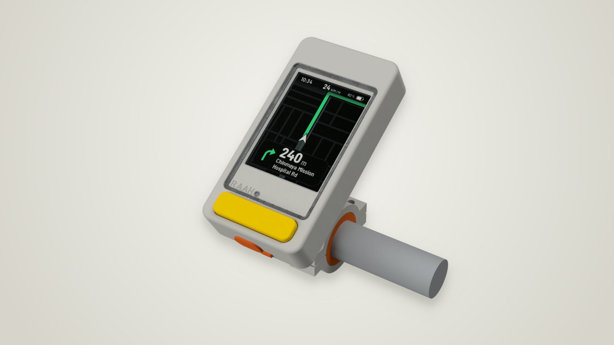
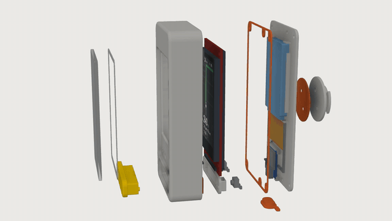

# Raah enclosure (R1): "Chin key"

A portrait slab for the handlebar. The face is one flush acrylic lens, and below it sits a single full-width yellow key you can hit with a glove. Every seal is orange, and that is the only other colour. The case does what it needs to and nothing more.

It is a DIY build: every part is 3D printed (ASA/PETG for the body, TPU 95A for all the seals), except the acrylic lens and the tape that holds it.

| | |
|---|---|
| Body | 59.6 × 114.8 × 21.8 mm, plus 6.4 mm for the quarter-turn tab |
| Board | Seeed XIAO ESP32C3 (21 × 17.8). It has its own LiPo charger and 3.3 V regulator, so there is no charger or regulator board. External FPC antenna. |
| Battery | 523450 LiPo, 1500 mAh (5.2 × 34 × 50), flat on the lid. Run time isn't estimated for the C3 yet; measure it. |
| Display | 2.8" ILI9341 (MSP2807), portrait. Fits either way up (see *Display flip*). |
| Sealing target | Rain and spray (IPX4–5 *intent*, **untested**). With printed TPU seals, don't count on surviving a dunk. |
| Mount | 22.2 mm bar (25.4 and 31.8 with TPU shims), 24-tooth spline tilt in 15° steps, Garmin-style quarter-turn |
| Model | Fusion doc "Raah - Handlebar Navigator R1" (unsaved), built by [fusion/raah_case.py](fusion/raah_case.py) |

## Concept

- **One sealed face.** A 2 mm cast-acrylic lens sits flush in a pocket on a die-cut 3M VHB 4905 ring. It covers both the display window and the light-sensor dot, so the face has no other openings.
- **Wordmark under glass.** "RAAH" is debossed into the pocket floor and read through the lens. The LDR behind the dot is its full stop.
- **The chin is the button.** A 46 × 12 mm yellow key (XIAO D3, GPIO5) sits 2.7 mm proud of the face. Two tact switches under its ends are wired in parallel, so a press anywhere along it clicks. It travels 0.75 mm, and the switches themselves are the stop. A printed TPU membrane keeps water out of the switches.
- **Face up.** On the bar the screen looks up and back at the rider: 30° off horizontal by default, and the spline lets you re-set it in 15° steps.
- **No sun visor.** R0 had one, but with the screen facing up a hood above it does nothing, so it was dropped. If glare is a problem, put an anti-glare film on the lens.
- **Colours** (as modelled): warm light-grey ASA body, signal-yellow PETG key and tilt knob (#FFD000, the UI's NEAR yellow), and orange TPU seals. Any colour can be printed; the renders avoid black on purpose.

## Waterproofing: every opening and how it's sealed

| Opening | Seal |
|---|---|
| Display window and LDR dot | Flush acrylic lens on a closed 2 mm VHB ring. Let it dwell 24 h before getting it wet. |
| Lid to shell | Lid sits inside a 1.2 mm skirt (overlap joint). A printed 0.8 mm TPU gasket sets to 0.7, and a continuous 0.6 × 0.3 mm **seal bead** on the rim bites into it. **Six** M2 screws (4 corners and 2 ends), each with a gasket pad around the screw. |
| Key | Stem runs in a guide sleeve. A printed 0.6 mm TPU membrane is clamped 0.1 mm between the guide end and the switch carrier (the carrier lands on its two screw ears, so the clamp can't be over-tightened). Only two Ø2.8 nubs on the stem, one over each switch, press it, so the membrane flexes around them. Stiff TPU could not shear through a thin band the way silicone does. |
| USB-C | A 13 × 6.8 tunnel through the bottom wall, as big as a cable's overmold. The XIAO's port sits 2.7 mm behind the face, so the overmold has to go in for the plug to seat fully. The tunnel floor is 1.2 mm above the gasket plane. A TPU plug with **two 0.3 mm sealing ribs**, a flange and a pull tab. The bottom end faces down and drains. |
| Tab screws (through the lid) | Printed 0.6 mm TPU gasket under the tab, around both screws |
| Pressure (optional) | Ø1.5 vent under an 8 mm adhesive ePTFE vent sticker inside the lid. This stops temperature swings pumping water past the seals and stops the lens fogging. **No sticker? Put a piece of tape over the hole** (the case is then simply sealed). |
| Printed walls | Print 4 perimeters and 5 top/bottom layers. A thin FDM wall weeps. |

The display gasket (TPU) is only a cushion and locator; the lens does the sealing.

**Printing the TPU seals** (lid gasket, key membrane, tab gasket, USB plug, display gasket):
- TPU 95A is fine. 85A seals better if you have it.
- Dry the filament first. Wet TPU prints porous.
- 0.2 mm layers (every seal is a whole number of layers), 100 % infill, and **concentric** top/bottom pattern, so the lines run along the seal and no line crosses it.
- Slow (20–25 mm/s), flow about 105 %, little or no retraction.
- Hold each flat seal up to a light. Any pinhole means print it again.
- A thin smear of petroleum jelly on the lid gasket and the plug ribs helps them seal and slide.

TPU 95A is far stiffer than silicone. Tighten the six lid screws in a cross pattern until the lid sits flush with the skirt. The bead does the sealing, so the gasket does not have to flatten everywhere.

**Test before trusting it:** put dry tissue inside, give it 5 minutes under a shower or a gentle hose spray from every side, and check for damp. Re-test after every reassembly.

## Parts

| Part | Material / process | Qty | Notes |
|---|---|---|---|
| Front shell | ASA (or PETG), print face-down on textured PEI | 1 | No supports. The USB tunnel ceiling is a 7 mm bridge. |
| Lid | ASA/PETG, print outside face down | 1 | XIAO seat, antenna plate, cell pocket, vent recess |
| Key | PETG yellow, print cap-down | 1 | Snap bumps on the stem click into grooves in the guide |
| Switch carrier | PETG, print top-down | 1 | Clamps the membrane. Two square cradles hold the tact switches, legs through the floor. A pad over the XIAO's USB-C keeps the board down. |
| Quarter-turn tab | ASA/PETG, print base-down | 1 | The ear undersides overhang 3.5 mm: use a little tree support |
| Receiver arm | ASA/PETG, print the socket face down | 1 | The chamber ceiling is a 3.7 mm bridge |
| Clamp upper / lower | ASA/PETG, print on the 16 mm side | 1 + 1 | M4 nut traps in the lower half |
| Tilt knob | PETG yellow | 1 | Holds the M5 nut |
| Bar shims 25.4 / 22.2 | TPU 95A | as needed | Fit the 31.8 clamp bore |
| USB plug | TPU 95A | 1 | Print it standing on the flange |
| Display gasket | TPU 95A, 0.6 face | 1 | Asymmetric lips locate the glass. It flips with the module. |
| Lid gasket | TPU 95A, 0.8 (4 layers) | 1 | Print flat |
| Key membrane | TPU 95A, 0.6 (3 layers) | 1 | Print flat |
| Tab gasket | TPU 95A, 0.6 (3 layers) | 1 | Print flat |
| Lens | 2.0 mm clear acrylic sheet ([template DXF](exports/raah_lens.dxf)) | 1 | 50.8 × 79.2, R3 corners. Print the DXF 1:1 on paper, score and snap along a ruler, then file and sand the corners. Glazing from a cheap photo frame works if it is acrylic, not glass. |
| Lens tape | 0.5 mm clear double-sided acrylic tape, VHB 4905 or similar ([template DXF](exports/raah_lens_tape_vhb.dxf)) | 1 | 2 mm band. Cut it with a craft knife on the paper template. |

STLs (in the assembly's position, so lay each one flat in the slicer) and the full assembly STEP are in [exports/](exports/).

**Hardware:**
- M2 heat-set inserts ×6 with M2×6 button-head screws ×6.
- M2.5 heat-set inserts ×2 with M2.5×6 countersunk screws ×2 (tab, driven from inside).
- M2×5 self-tapping screws for plastic ×2 (switch carrier).
- M4×14 screws and nuts ×2.
- M5×20 socket-head screw and nut ×1.
- 8 mm ePTFE vent sticker (optional, see above).
- 6×6×5 through-hole tact switches ×2 (5.0 mm tall, not 5.5) and a GL5528 LDR.
- Seeed XIAO ESP32C3 with the FPC antenna that comes with it, and a 523450 LiPo with its protection board.
- Battery sense: 1 MΩ resistors ×2 and a 100 nF capacitor. LDR: one 10 kΩ resistor. Solder them inline on the wires and heat-shrink them.
- 1 mm double-sided foam tape (XIAO posts, and the pad under the cell), 26–28 AWG silicone wire, heat-shrink.

Where to buy all of this in India: see [Buying the parts in India](#buying-the-parts-in-india).

## Assembly order

1. Heat-set the 6 M2 inserts into the shell columns and the 2 M2.5 inserts into the tab.
2. Clean the lens and pocket with IPA. Fit the VHB ring to the lens, press it into the pocket hard for 30 s, and leave it 24 h.
3. Press the LDR into its cup from inside, leads out the back.
4. Key switches:
   - Each switch has four legs, joined inside in two pairs. With a meter on beep, find two legs next to each other (not diagonal) that beep only while you press.
   - Turn the switch so those two are on the chin side (toward the bottom of the case), and snip the other two off flush with the body. The square cradle and its holes take the switch either way round. Do the same with the second switch.
   - Drop each switch into its cradle, legs through the floor, and bend the legs flat under it. Solder one leg of each switch to the XIAO's D3 and the other to GND: the two switches in parallel.
   - Keep the joints and wires on the chin side, and put a strip of Kapton tape over them.
   - Push the key in from the front until it clicks. Lay the membrane on the guide end and screw on the carrier.
   - Press the key in the middle and at both ends. It should click every time. If one end doesn't click, stick a layer of tape on that nub tip. If the key feels dead or a switch stays pressed, sand that nub tip.
5. Display:
   - Trim the header pins to about 1.5 mm past the plastic body and solder wires to them. Full-length pins hit the XIAO's parts.
   - Put the gasket on the glass and push the module in until the four arms click over the PCB.
6. Screw the tab and its gasket to the lid from inside. Stick the vent over its hole.
7. Lid internals (see [06_inside_lid](renders/06_inside_lid.png)):
   - Stick the FPC antenna on the plate between the XIAO seat and the cell pocket, with its cable end on the left.
   - Tin the XIAO's BAT+ and BAT− pads (underside, mid-board, on the D0–D6 edge) and solder the cell leads to them. **Check polarity first.** Add the battery-sense divider on the BAT+ lead.
   - Foam tape on the four posts. Press the XIAO in, top side up (toward the face), USB-C against the bottom wall. The guides and stops locate it.
   - Plug the antenna into the U.FL socket beside the USB-C. Lead the coax over the board's 5V edge, out past the left switch cradle, down to the lid and up the left side to the antenna. Coil the slack there (the cable is about 80 mm).
   - Cell on its foam pad, protection board toward the antenna. Run its leads down the right side and under the XIAO, as modelled.
   - Wire the display, key and LDR (pin map under *Electronics notes*). Leave the wires long enough to open the case like a book.
8. Lid gasket on, lid closed, and the 6 screws tightened evenly in a cross pattern (snug, not crushed). Fit the USB plug.
9. Mount: shim if needed, clamp onto the bar, then the receiver on the spline with the M5 and knob. Set the tilt and quarter-turn the device in.

## What's inside

From the face back:
- **2.8" ILI9341 display**, with its TPU gasket behind the window.
- **Key switches**: two 6×6 tact switches in printed cradles under the ends of the yellow key, wired in parallel. The **GL5528 LDR** (light sensor) sits in its cup behind the "RAAH." dot.
- On the lid, from the chin up ([06_inside_lid](renders/06_inside_lid.png)):
  - **XIAO ESP32C3**, top side toward the face, its USB-C in the bottom wall. It charges the cell (about 380 mA) and makes the 3.3 V for everything. 2.5 mm under it for the cell leads.
  - **FPC antenna** (40 × 20), on the lid plate. The C3 has no antenna of its own, so BLE needs this plugged in. It sits clear of the cell's foil and about 8 mm behind the display.
  - **523450 LiPo**, 1500 mAh, on a foam pad in low walls. The pocket takes cells up to about 7 mm thick, so a 603450 or 703450 also fits.

## Buying the parts in India

All of these come from Indian stores.

| Part | Ask for | Where |
|---|---|---|
| Board | **Seeed Studio XIAO ESP32C3**, the standard one, which comes with an FPC antenna. The tape-and-reel version has no antenna. | [element14 India](https://in.element14.com/seeed-studio/113991054/development-board-risc-arduino/dp/4060379) (part 113991054, cheapest at about ₹425 + GST), [Robobazar](https://robobazar.in/product/seeed-studio-xiao-esp32c3/), [Robu](https://robu.in/product/seeed-studio-xiao-esp32c3-tiny-mcu-board-with-wi-fi-and-ble-battery-charge-supported-power-efficiency-and-rich-interface/), [Robotools](https://robotools.in/shop/electronic-components/semiconductor-ics/microcontroller-ic/seeed-studio-xiao-esp32c3-tiny-mcu-board-with-wi-fi-and-ble-battery-charge-supported-power-efficiency-and-rich-interface) |
| Cell | **523450 3.7 V 1500 mAh LiPo** with protection board and leads (KP-523450 or similar), 5.2 × 34 × 50 | [Hubtronics](https://hubtronics.in/523450-lipo-battery) (about ₹277), [Zbotic](https://zbotic.in/product/kp-original-523450-1500mah-3-7vsingle-cell-rechargeable-lipo-battery/), [Robobazar](https://robobazar.in/product/3-7v-1500mah-lithium-polymer-lipo-rechargeable-battery-model-kp-523450), [Robocraze](https://robocraze.com/products/3-7v-1500mah-lipo-rechargeable-battery-model-uk-523450p) (was out of stock) |
| Small parts | Two 1 MΩ and one 10 kΩ ¼ W resistors, a 100 nF ceramic capacitor, silicone wire, heat-shrink, 1 mm foam tape | Any electronics shop (Lamington Road, SP Road, etc.), Robu, Robocraze |
| Key switches ×2 | 6×6×5 mm 4-pin through-hole tact switch. It must be **5.0 mm** tall: with a 5.5 mm one the key has almost no travel, so sand 0.5 mm off each nub. | [Robocraze](https://robocraze.com/products/4-pins-dip-momentary-square-tactile-push-button-switch-10-pieces-6x6x5mm) |
| Light sensor | GL5528 5 mm LDR | [ifuturetech](https://ifuturetech.org/product/ldr-5528-sensor) |
| Seals | TPU 95A, 1.75 mm | [Robocraze (Anycubic)](https://robocraze.com/products/anycubic-tpu-95a-white-1kg-flexible-1-75mm-3d-printer-filament), [Zbotic (eSun)](https://zbotic.in/product/esun-tpu-95a-1-75mm-3d-printing-filament-1kg-black/) |
| Inserts | M2 and M2.5 brass heat-set inserts | Robu, [FlyRobo (M2.5)](https://www.flyrobo.in/m2.5-x-5mm-brass-heat-set-threaded-round-insert-nut) |
| Lens | 2 mm clear acrylic | Any acrylic or signboard shop. Many will cut it to the DXF for you. |
| Lens tape | 0.5 mm clear double-sided acrylic tape (3M VHB 4905 or similar) | Amazon.in, hardware shops |
| Vent sticker | ePTFE vent | Hard to find in India. Skip it and tape over the hole. |

## Display flip

The window is centred on the active area. The cavity is the union of both module orientations, so module and gasket can turn 180° together and nothing else moves. Firmware Mirror X/Y puts the picture right. The interference check passes both ways.

## Electronics notes

XIAO wiring. The firmware's C3 port uses exactly these pins ([cupcake08/raah#1](https://github.com/cupcake08/raah/pull/1), branch `xiao-c3`; it builds but hasn't run on a board yet):

| XIAO pin | GPIO | Goes to |
|---|---|---|
| 3V3, GND | | Display VCC and GND, LDR, key, dividers |
| D4 / D5 | 6 / 7 | Display SCK / SDI (MOSI). These are the C3's direct SPI pins. |
| D10 | 10 | Display CS |
| D8 | 8 | Display DC |
| D7 | 20 | Display RESET |
| D6 | 21 | Display LED (backlight) |
| D3 | 5 | Key: both switches to GND. GPIO0–5 are the only pins that can wake the C3 from deep sleep. |
| D2 | 4 | Battery sense: BAT+ → 1 MΩ → D2 → 1 MΩ → GND, 100 nF from D2 to GND |
| D1 | 3 | LDR: 3V3 → GL5528 → D1 → 10 kΩ → GND |
| D0, D9 | 2, 9 | Leave free: these are strapping pins. |
| BAT+ / BAT− (underside) | | The cell |

- **Charging:** the XIAO charges the cell from its own USB-C at about 380 mA, roughly 0.25C for a 1500 mAh cell, which is gentle enough for a sealed case. There's no charge-status GPIO.
- **3.3 V:** the XIAO's regulator is rated 500 mA, which covers BLE and the backlight.
- **Flashing:** the C3's native USB normally lets esptool reset the board into download mode with no buttons. The XIAO's B and R buttons are inside the case. The firmware restarts into USB download mode when the key is held for about 10 s, so a bad build only means opening the lid if it hangs before that check. The console is on USB Serial/JTAG, since D6 and D7 are the UART pins.
- **Antenna:** the C3 has no on-board antenna. BLE needs the FPC plugged into the U.FL socket.
- **LDR:** it now sees through the lens and a Ø3.1 hole, so recalibrate the thresholds. Ignore LDR readings while the key is pressed, since a thumb can shadow the dot. Its divider draws about 0.1–0.3 mA in daylight, even in sleep.
- **Header height:** the XIAO's parts sit about 0.9 mm under the trimmed header pins, so trim them as step 5 says.
- **Key:** two switches in parallel on D3, so the firmware sees one button.

## Checks

The interference check covers every printed part, gasket and the lens. It also covers the XIAO (PCB, USB-C, U.FL, BAT pads), the antenna and its coax route, the display, the cell and its leads, and both key switches with their legs and solder joints. It finds **0 clashes** with the display either way up. The only overlaps are intended squeezes:
- lid gasket set by 0.1, plus the seal bead's 0.3
- USB plug ribs (0.3)
- membrane clamp (0.1)

**Key travel:**
- Each nub rests 0.1 above the membrane, the membrane sits 0.4 above its switch, and the switch travels 0.25. So the key moves 0.75 to the stop, which is the switches themselves.
- At full travel only the nubs touch the membrane; the stem walls stay clear.
- At rest the cap is 1.3 above the pocket floor.

**End presses:** pressed at one end, the key tilts until the stem meets its slot, at about 1.5°. The cap would only reach the pocket floor past 2°, so an end press always drives that end's switch to its stop.

**Clearances:**
- The leg joints (modelled 1.5 mm deep) clear everything below them, in either turn.
- The XIAO's tallest parts are 0.9 under the trimmed header pins. The carrier pad is 0.1 above the USB-C.
- The lower corner screw columns sit up the sides, 0.5 clear of the switch cradles and under the carrier screw heads. The top-middle column stops 0.6 short of the flipped module's header pins.
- The cell is 2.0 under the display's back parts.

## Not verified

- **Quarter-turn dimensions** are my best estimate of the Garmin pattern. Print the tab and receiver as a coupon first.
- **Sealing** hasn't been tested (see the dunk test above). TPU 95A seals are the weak point. With six M2 screws the lid gasket may not take a full set.
- **Key feel** depends on the switch and membrane stack. 0.75 mm to the stop is the design number, and FDM tolerances will need the nubs tuned (see the assembly steps).
- **Key guide fit.** End presses rely on the stem being snug in its slot (0.15 a side as modelled). If an end press rocks the key without a click, print the key a touch fatter, or put tape on that nub.
- **Tact switch pinout** isn't the same from every maker. That is why the cradle takes either turn and step 4 finds the right pair with a meter.
- **Lens on VHB** is the one joint that isn't screwed. It peels off with heat if the lens needs replacing.
- The M2.5 tab inserts have about 0.8 mm of wall to the neck. If they crack the neck, use M2.
- **XIAO dimensions** are from Seeed's footprint and listings: PCB 1.2, USB-C 3.26 tall, U.FL beside the USB-C on the 5V edge. Measure your board. The USB tunnel has about 0.4 mm of slack each way.
- **Antenna size** (40 × 20 FPC, 80 mm coax) comes from one supplier report. The plate has about 1 mm spare each way. Test BLE range with the lid closed, since the antenna sits behind the display and near the bar.

## Renders

[renders/](renders/) contains:
- 01 hero (mounted)
- 02 face
- 03 side (tilt)
- 04 back with mount
- 05 back (tab, screws, vent)
- 06 inside the lid
- 07 inside the shell
- 08 exploded

**Animations** (1280 × 720, 30 fps, plus 640 px GIFs):
- [raah_assembly.mp4](renders/raah_assembly.mp4) ([gif](renders/raah_assembly.gif)), 10 s. The exploded parts fly in, in build order. Then the closed device drops onto the bar mount and quarter-turns to lock.
- [raah_turntable.mp4](renders/raah_turntable.mp4) ([gif](renders/raah_turntable.gif)), 6 s. One seamless turn of the mounted device.

**Product renders for sharing** (ray-traced with Fusion's local renderer):
- [renders/hq/](renders/hq/): 1080p JPGs on a soft studio backdrop (hero, face, three-quarter, side, back, inside, exploded), plus each one as a transparent `_cutout.png`.
- [raah_showcase.mp4](renders/raah_showcase.mp4): a 21 s, 720p film of those shots with slow push-ins and the turntable.
- [raah_turntable_hq.mp4](renders/raah_turntable_hq.mp4) ([gif](renders/raah_turntable_hq.gif)): a 5.3 s ray-traced turn.
  - It covers 320° (frames 0–127 of 144), so it does not loop seamlessly yet. Frames 8, 66 and 120 are blends of their neighbours.
  - Rendering stopped there because the Mac was throttled on a weak charger.
  - Re-rendering face, three_quarter and hero with the matte LCD border would also remove a faint streak around the screen.

[fusion/raah_render.py](fusion/raah_render.py) queues the shots: `start(name, out_dir)` for a still, `turntable(out_dir, start, end)` for frames. Fusion renders one job at a time and snapshots the scene when a job is queued, so many jobs can be queued at once. A still at Final quality (75) takes 1–6 min; the face, mostly lens, is slowest. A turntable frame at quality 50 and 720p takes about 17 s. While jobs are queued, Fusion's script bridge can stop answering for minutes; it comes back on its own.

[fusion/finish.sh](fusion/finish.sh) puts the stills on the backdrop, and [fusion/film.sh](fusion/film.sh) cuts the film. Both use [fusion/backdrop.sh](fusion/backdrop.sh) (ffmpeg).

What keeps the screen clean:
- The *Soft Light* environment. The others mirror a dark gap in the studio as a band across the lens.
- A matte LCD face and an opaque VHB ring. Glossy or translucent surfaces render as streaks behind the acrylic.
- A 4× copy of the 240 × 320 screenshot with hard pixel edges ([fusion/assets/screen_map_4x.png](fusion/assets/screen_map_4x.png)).

The animations above are viewport captures driven by [fusion/raah_anim.py](fusion/raah_anim.py), because Fusion's Animation workspace has no API. [fusion/stitch.sh](fusion/stitch.sh) composites them onto a light background with ffmpeg. The script only moves occurrences and the camera, and it puts every part back after each batch.

To rebuild: open a design marked `raah/design = enclosure-r1` and run `build(['refs','tub','front_parts','lid','tab','mount','check','look','export','render'])` from the script. For the animations, call `render('assembly', start, end, frames_dir)` and `render('turntable', …)` from raah_anim.py, in batches of about 80 frames (304 and 180 frames in all). Then run `stitch.sh frames_dir`.
